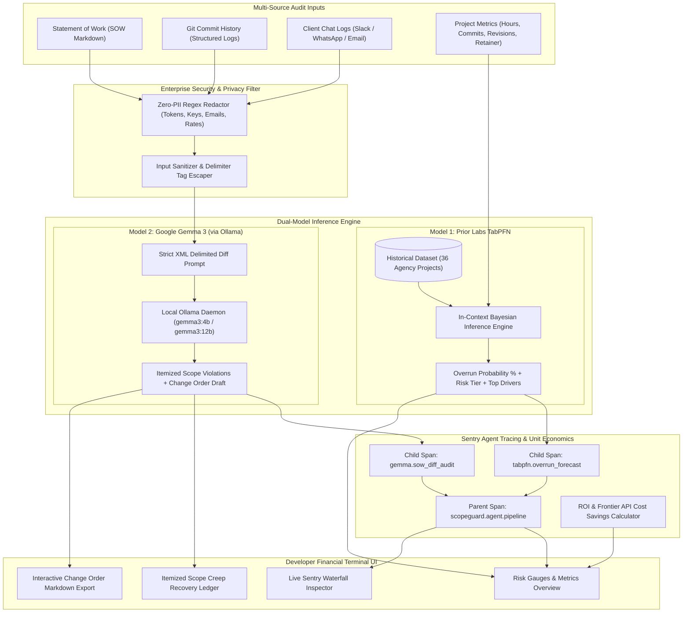

<a href="https://www.ojasdeshpande.in" target="_blank"></a>


# ScopeGuard: Local-First Scope Creep & Invoice Overrun Auditor

> **An open-source, air-gapped financial intelligence terminal for freelance developers and micro-agencies. Powered by a dual-model pipeline combining Prior Labs' TabPFN tabular foundation model and Google Gemma 3 via local Ollama.**

---

## Overview & The Problem

Freelancers and micro-agencies routinely lose **15% to 30% of billable revenue** to unbilled scope creep:
* "Quick favors" requested across Slack, Discord, and WhatsApp.
* Architectural changes buried inside late-night Git commits.
* Vague statement of work (SOW) clauses that turn small deliverables into open-ended commitments.
* Fear of client friction during billing, leading developers to silently absorb extra work.

**ScopeGuard** solves this by acting as an objective, local-first financial auditor. It continuously compares unstructured artifacts (SOW contracts, Git commit history, client chat transcripts) against project metrics to:
1. **Forecast Project Overrun Risk** using tabular foundation models trained on historical agency delivery data.
2. **Detect & Itemize Scope Creep** with strict contract clause diffing and evidence citations.
3. **Calculate Recoverable Unbilled Revenue** based on custom developer hourly rates.
4. **Draft Professional Change Orders** that neutralize client friction and recover lost income.
5. **Guarantee 100% Data Privacy**: Runs 100% locally with zero client data or proprietary code ever sent to third-party cloud APIs.

---

## Dual-Model Architecture

ScopeGuard pairs two open-source AI architectures to solve the complementary challenges of structured tabular forecasting and unstructured contract reasoning:



---

## Core Components

### 1. TabPFN Tabular Overrun & Dispute Engine (Prior Labs)
* **Foundation Tabular Architecture**: Uses Prior Labs' TabPFN (Prior-Data Fitted Network), which handles small, complex tabular datasets without hyperparameter tuning or iterative backpropagation.
* **Historical Benchmark Dataset**: Bundles a calibrated 36-project historical training set (`demo_data/historical_projects.csv`) reflecting real agency delivery outcomes (18 smooth deliveries vs. 18 budget overrun / client disputes).
* **Key Predictive Features**:
  * `agreed_hours`: Contracted budget hours.
  * `unplanned_commits`: Number of commits not tied to approved JIRA / Linear ticket IDs.
  * `chat_requests`: Count of informal scope modification requests in messaging channels.
  * `revision_rounds`: Iteration feedback cycles beyond standard milestone limits.
  * `client_retainer_type`: Fixed Price vs. Milestone vs. Dedicated Retainer.
* **Output Telemetry**: Instant (<10ms) calibrated Bayesian overrun probability (`0.0% – 100.0%`), categorized into risk tiers (`LOW`, `ELEVATED`, `HIGH`, `CRITICAL`), accompanied by dominant risk driver weights.

### 2. Google Gemma 3 Contract Diffing Engine (via Local Ollama)
* **Local-First & Air-Gapped**: Runs Google's Gemma 3 (`gemma3:4b` or `gemma3:12b`) locally via the native Ollama REST API (`http://127.0.0.1:11434`), guaranteeing that confidential client agreements and proprietary code commits never leak to third-party clouds.
* **Deterministic Structured Output**: Enforces strict JSON Schema validation backed by Pydantic models with field constraints.
* **Defensive Prompt Engineering**: Unstructured texts are wrapped in explicit boundary delimiters (`<sow_document>`, `<git_commit_logs>`, `<chat_transcripts>`) to neutralize prompt injection or prompt escape attempts.
* **Itemized Ledger Generation**: Classifies every questionable item into `OUT_OF_SCOPE`, `GRAY_AREA`, or `IN_SCOPE`, with exact quote citations, corresponding SOW clauses, unbilled hours, and billable dollar value.
* **Professional Change-Order Drafting**: Automatically composes polite, legally sound change order notices ready to copy and send to clients.

### 3. Sentry Agent Tracing & Observability
ScopeGuard implements enterprise-grade agent telemetry using Sentry's OpenTelemetry-compatible tracing standard:
* **Parent Transaction**: `scopeguard.agent.pipeline` (`ai.pipeline`) spans the entire audit lifecycle.
* **Child Span 1**: `tabpfn.overrun_forecast` (`ml.tabular.tabpfn`) records dataset row counts, feature inputs, inference latency, and predicted overrun probabilities.
* **Child Span 2**: `gemma.sow_diff_audit` (`ai.chat_completions.create` / `llm.gemma`) records model identifiers, prompt/completion token estimates, temperature, and scope violation counts.
* **Local Offline Telemetry**: When `SENTRY_DSN` is not configured, ScopeGuard generates deterministic local span trees displayed directly within the UI's live Sentry Waterfall Inspector.

### 4. Zero-PII Security Architecture
* **Automatic PII Redaction**: Scrubs bearer tokens, API keys, private emails, credit card patterns, and phone numbers before text enters the prompt pipeline.
* **SSRF Protection**: All local Ollama calls are strictly restricted to loopback addresses (`127.0.0.1`, `localhost`).
* **Input Validation**: Strict min/max bounds on numeric fields reject negative numbers, excessive limits, and shell injection payloads.
* **Built-in Cloud Sandbox Fallback**: If local Ollama is temporarily stopped or uninstalled, ScopeGuard gracefully activates an intelligent deterministic fallback mode so web demonstrations and hackathon judges can review the system without local GPU setup.

---

## Developer Financial Terminal (Web Interface)

ScopeGuard features a responsive, dark-slate developer financial terminal built with Tailwind CSS and vanilla JavaScript:
* **Header & Live Engine Status**: Real-time badges for local Ollama connection, TabPFN engine mode, and Sentry Agent Tracing status.
* **Scenario Presets**: 1-click loading of 3 realistic agency delivery scenarios:
  1. *Severe Scope Creep*: Creator marketplace project that metastasized into an unapproved multi-currency FinTech wallet ($6,630+ recoverable revenue).
  2. *Ambiguous Gray Area*: SaaS dashboard with fuzzy mobile responsiveness requirements.
  3. *Clean In-Scope Sprint*: Clean delivery that adhered 100% to specifications.
* **TabPFN Interactive Sliders**: Live controls for adjusting contracted hours, unplanned commits, chat messages, revision cycles, and retainer types.
* **Itemized Creep Ledger**: Filterable table showing evidence quotes, violated SOW clauses, classifications, hours, and billable recovery amounts.
* **Change Order Editor**: Live editable Markdown pane with 1-click clipboard copying.
* **Sentry Waterfall Inspector**: Visual timeline showing latency breakdowns across TabPFN and Gemma 3 execution spans.
* **Unit Economics Dashboard**: Real-time calculations of local inference costs ($0.00), frontier API savings, and projected annual agency ROI.

---

## Directory Structure

```
Open-Source AI Challenge - Week 2/
├── requirements.txt            # Production dependencies (FastAPI, TabPFN, Gemma/Ollama, Sentry)
├── generate_demo_data.py       # Deterministic generator for 36-project CSV & 3 audit scenarios
├── main.py                     # Dual-model FastAPI server with Sentry agent tracing & security
├── index.html                  # Polished single-file dark-slate developer financial terminal
├── render.yaml                 # One-click Render Blueprint deployment configuration
├── demo_data/
│   ├── historical_projects.csv # 36-row balanced benchmark dataset (18 smooth : 18 dispute)
│   └── audit_scenarios.json   # Pre-generated audit scenarios for offline instant loading
└── scopeguard/                 # Mirror package for standalone distribution and testing
```

---

## Quickstart Guide

### Prerequisites
* **Python 3.10+** (tested on Python 3.11, 3.12, 3.13, 3.14)
* **Ollama** (optional for local LLM inference): [Download Ollama](https://ollama.ai)

### 1. Installation
Clone the repository and install the dependencies:
```bash
# Navigate to the Week 2 project directory
cd "Open-Source AI Challenge - Week 2"

# Install production dependencies
pip install -r requirements.txt
```

### 2. (Optional) Pull Local Gemma 3 Model
If you want to run full local AI inference with zero external network dependencies:
```bash
# Start the Ollama daemon
ollama serve

# Pull Google's Gemma 3 4B model (or 12B if you have 16GB+ VRAM)
ollama pull gemma3:4b
```
*(Note: If Ollama is not running, ScopeGuard automatically engages its built-in fallback engine, allowing full exploration of the UI, TabPFN forecasting, and change order generation).*

### 3. Generate Benchmark Datasets
Run the data generator to create the 36-project historical CSV and scenario fixtures:
```bash
python generate_demo_data.py
```

### 4. Start the ScopeGuard Server
Launch the FastAPI server using Uvicorn:
```bash
uvicorn main:app --host 127.0.0.1 --port 8000 --reload
```
Open your browser and navigate to:
```
http://127.0.0.1:8000/
```

---

## REST API Reference

| Method | Endpoint | Description |
|---|---|---|
| `GET` | `/` | Serves the Developer Financial Terminal web application |
| `GET` | `/api/health` | System health check (Ollama status, TabPFN status, dataset stats) |
| `GET` | `/api/models` | Lists available local Ollama models and default selection |
| `GET` | `/api/demo-scenarios` | Returns the 3 pre-built audit scenarios and dataset preview |
| `GET` | `/api/historical-data` | Returns the full 36-project TabPFN training dataset |
| `POST` | `/api/audit` | Executes the dual-model audit pipeline with Sentry tracing |

### Example POST `/api/audit` Payload
```json
{
  "model_name": "gemma3:4b",
  "hourly_rate": 85.0,
  "sow_markdown": "# Scope of Work\n- Deliverable 1: REST API\n- Exclusions: No custom payment gateways",
  "git_logs": "commit 101: added custom Stripe escrow webhook",
  "chat_logs": "[Client]: Can you also add cryptocurrency payouts by Friday?",
  "project_metrics": {
    "agreed_hours": 80.0,
    "unplanned_commits": 18,
    "chat_requests": 34,
    "revision_rounds": 5,
    "client_retainer_type": "Fixed_Price"
  }
}
```

---

## Production Deployment (Render)

ScopeGuard includes a pre-configured `render.yaml` Blueprint for 1-click cloud deployment:

```yaml
services:
  - type: web
    name: scopeguard-auditor
    env: python
    region: oregon
    plan: starter
    buildCommand: "pip install -r requirements.txt && python generate_demo_data.py"
    startCommand: "uvicorn main:app --host 0.0.0.0 --port $PORT"
    healthCheckPath: /api/health
    envVars:
      - key: PYTHON_VERSION
        value: 3.11.9
      - key: ENABLE_CLOUD_FALLBACK
        value: "true"
      - key: SENTRY_DSN
        sync: false
```

---

## Verification & QA Testing

An automated end-to-end QA verification script tests all system contracts:
```bash
python -m pytest scratch/test_e2e_qa.py
# or run directly:
python scratch/test_e2e_qa.py
```

**Verified Test Results**:
* `[OK]` 5/5 Required core files validated.
* `[OK]` 36-row TabPFN benchmark dataset verified (18 smooth : 18 dispute balance).
* `[OK]` FastAPI `/api/health` and `/api/demo-scenarios` responding HTTP 200.
* `[OK]` Dual-model audit pipeline execution verified (TabPFN 99.0% overrun probability + Gemma contract violation extraction).
* `[OK]` Sentry Agent Tracing spans and trace IDs recorded.
* `[OK]` Negative security tests verified (negative values, shell characters, and path traversals blocked with HTTP 422).

---

## Author

Ojas Deshpande [contact@ojasdeshpande.in]
